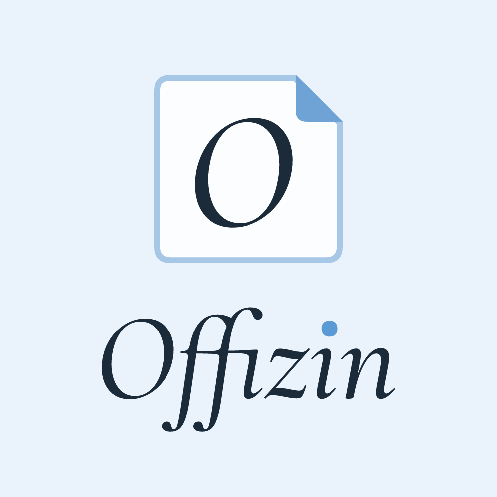

<p align="center">
  
</p>

<p align="center"><strong>Desktop publishing for Microsoft Word and Google Docs.</strong><br>
Brochures, newsletters, flyers, cards, and more, built from templates in your own colors, fonts, and business details.</p>

<p align="center">
  <a href="https://offizin.alyssaagard.dev">Website</a> &nbsp;|&nbsp;
  <a href="https://offizin.alyssaagard.dev/demo/">Try it in your browser</a> &nbsp;|&nbsp;
  <a href="https://offizin.alyssaagard.dev/word/">Install for Word</a> &nbsp;|&nbsp;
  <a href="https://offizin.alyssaagard.dev/google-docs/">Install for Google Docs</a>
</p>

---

Microsoft Publisher reached its end of life in October 2026. Offizin keeps the parts of Publisher people relied on, and puts them inside the word processor they already use. It is free and open source for personal, business, school, and enterprise use, it needs no account, and it has no server.

*Offizin* is the old German word for a printing house; Gutenberg's workshop was an Offizin.

## What it does

| Publisher feature | In Offizin |
|---|---|
| Publication gallery | 33 publications, each for Letter or A4 paper: tri-fold and bi-fold brochures; newsletter; event flyer, sale flyer, poster, sign, and photo page; business cards, postcards, greeting card, invitation, bookmarks, and place cards; event program, menu, and booklets of 4 to 16 pages; letterhead, envelope, and invoice; address labels, name badges, and tickets; a designed resume plus six plain resumes and CVs that screening software reads reliably; monthly calendar, certificate, and gift certificates. |
| Page setup and layout | Customize each publication: paper size, orientation, margins (with Word's Narrow, Moderate, Normal, and Wide presets), text size, line spacing, paragraph spacing, padding, and the gaps between columns. Default spacing and text for everything live on the Design tab. |
| Color schemes and font schemes | 14 color schemes, led by two black and white schemes (Ink is the default), 8 font pairings, your own colors, and your own fonts. Restyle a finished publication and keep its text. |
| Mail merge | Paste a list from Excel or Google Sheets, or open a .csv file, to print one label, envelope, name badge, ticket, place card, or certificate per person. |
| Business information sets | Name, title, organization, tagline, address, phone, email, website, social handle, profile link, and logo, filled into every template. Keep several sets. |
| Building blocks (page parts) | 14 parts: pull quote, sidebar, coupon, attention getter, event details, contact block, call to action, picture with caption, logo, two columns, schedule table, divider, testimonial, and heading. |
| Styles and sections | Publications use the editor's own styles (Title, Heading 1, Heading 2, Normal), real text columns and page number footers in Word, and booklets printed in the right order. |
| Print settings | Mirror margins, two pages per sheet, book fold for booklets, and embedded fonts, kept in the Word document where Word allows it, plus step by step print help for two-sided printing and actual size in every editor. |
| Undo and redo | Offizin's own Undo, Redo, and history list reverse only what Offizin did, and leave your typing and the editor's own Undo alone. |
| Example text | Plain placeholders for names, dates, prices, and contact details, and Middle High German filler for running text, the way Word and Docs use Latin. The Design Checker finds every line of it. |
| Picture placeholders | Real placeholder images sized to their frames. Use Change Picture (Word) or Replace image (Google Docs). |
| Design Checker | Finds leftover sample text, unreplaced pictures, and missing business information, and selects each one. |
| Brand kit | Save colors, fonts, spacing, information sets, and logo as one file to share with a team. |

Try all of it, with no install, at **[offizin.alyssaagard.dev/demo](https://offizin.alyssaagard.dev/demo/)**. The demo can also download any publication as a Word file, which Google Docs opens too.

## Install

**Word**: in Word on the web, add the manifest with Upload My Add-in; on a Mac, put it in Word's wef folder; on Windows, add it from a shared folder. Organizations can deploy it to everyone from the Microsoft 365 admin center with one link or the same file. Steps: [offizin.alyssaagard.dev/word](https://offizin.alyssaagard.dev/word/).

**Google Docs** (personal accounts and Google Workspace): paste three files into a document's Apps Script editor once, then copy that document whenever you need a new publication. Each copy asks for permission the first time Offizin opens in it, and saved details stay with the document they were entered in, so save a brand kit once and open it in each copy. IT teams can upload the files with Google's clasp tool instead. Steps: [offizin.alyssaagard.dev/google-docs](https://offizin.alyssaagard.dev/google-docs/).

**Packages**: [offizin-word.zip](https://offizin.alyssaagard.dev/download/offizin-word.zip) and [offizin-google-docs.zip](https://offizin.alyssaagard.dev/download/offizin-google-docs.zip) hold the install files with a plain text guide, for sharing or for an IT team.

## Privacy

Offizin collects nothing. Documents are built inside Word or Google Docs, and settings are stored in your browser or your own Google account. See the [privacy policy](https://offizin.alyssaagard.dev/privacy/).

## How it is built

One set of templates, three renderers:

```
templates + your design  ->  composer  ->  layout model  ->  web preview (demo, thumbnails)
                                                        ->  Word (.docx written in the browser)
                                                        ->  Google Docs (Apps Script DocumentApp)
```

```
offizin/
  docs/                       The website, published by GitHub Pages
    app/core/                 Templates, schemes, and the composer (shared by everything)
    app/render/               Web preview, Word (.docx) writer, zip, picture placeholders
    app/hosts/                Word, Google Docs, and demo adapters
    app/ui/                   The panel used by all three
    word/                     Word task pane and manifest
    google-docs/              Built Google Docs files for the install page
    download/                 Built install packages for Word and Google Docs
    demo/                     The live demo (try/ redirects here)
  google-docs/                Apps Script source: Code.gs, appsscript.json, sidebar template
  brand/                      Logo generator and the logo font (SIL Open Font License)
  scripts/                    Build, checks, local server, and site settings
```

The browser code is plain JavaScript modules with no frameworks and no runtime dependencies.

## Development

You need Node.js 18 or later.

```bash
npm run build    # writes the Word manifest, the bundled Google Docs files, and the packages
npm run check    # composes every template, validates the Word XML, runs Code.gs against a
                 # simulated Google Docs, and tests the panel, history, hosts, and packages
npm run serve    # serves the website at http://localhost:8080
npm install && npm run brand   # only to regenerate the logo and icons
```

To add a template, add an entry to `TEMPLATES` in `docs/app/core/templates.js`. It appears in the gallery, the demo, Word, and Google Docs at once. Run `npm run build` and `npm run check` before committing; the GitHub workflow runs the same checks.

Maintainer notes (publishing, the custom domain, the Google starter document, store listings, and moving the project to a company account) are in [MAINTAINING.md](MAINTAINING.md).

## History

Offizin 2.0 replaces three earlier repositories, which are kept for reference: [layout-toolkit-V1](https://github.com/alyssaagard/layout-toolkit-V1) (Word on the web), [layout-toolkit-V2](https://github.com/alyssaagard/layout-toolkit-V2) (Word desktop), and [layout-toolkit-gdocs](https://github.com/alyssaagard/layout-toolkit-gdocs) (Google Docs).

## License

[MIT](LICENSE). Copyright 2026 Alyssa I. Agard.

Offizin is not affiliated with Microsoft or Google. Microsoft, Word, and Publisher are trademarks of the Microsoft group of companies; Google Docs and Google Workspace are trademarks of Google LLC.
